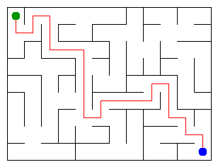

# Assignment 3. Maze Escape

Student ID: 252646
Name: Bogdan Tkachuk
Group: SE-2511
Maze size (rows x columns): 9 x 12

This file is the report. Fill it in as you go. How to start: `START_HERE.md`. The task: `docs/Assignment3.pdf`.

## Program output

The 13 lines your program prints on your data (`java -cp out Main`):

    Broken: 107
    Kept: 88
    Last broken wall: 166
    MST cost: 35430
    Heaviest broken wall: 965
    Path length: 25
    DFS visited: 65
    Dead ends: 32
    Zones: 9
    Largest zone: 18
    Is DAG: 0
    Flow stages: 5
    Fastest route cost: 28

My maze:

## Questions

Answer in your own words, two or three sentences each.

Mission 0. What do find and union do, and what makes them fast in your code?

Every group is a tree, and its root is the name of the group. find(x) goes up from x to the root. union(a, b) finds the two roots; if they are the same it returns false, otherwise it puts the smaller tree under the root of the bigger one and returns true. It is fast because of union by size (the trees stay low, height at most log n) and path compression (after find, every cell on the way points straight to the root), so one operation is almost O(1).

Mission 1. Why is Broken always R*C - 1, and Kept always (R-1)*(C-1)?

At the start every cell is its own group, so there are R*C groups. A wall is broken only when union returns true, and then two groups become one, so every broken wall removes exactly one group. At the end all cells are one group, so R*C - 1 walls are broken and the result is a spanning tree with no cycle. There are R*(C-1) + C*(R-1) inner walls, and R*(C-1) + C*(R-1) - (R*C - 1) = (R-1)*(C-1) of them stay. My maze: 107 = 9*12 - 1 broken, 88 = 8*11 kept.

Mission 2. My MST cost from Kruskal and from Prim, and why they are equal:

Both give 35430. Kruskal takes the walls from the cheapest to the most expensive and breaks a wall if it joins two different groups. Prim starts from cell 0 and every time adds the cheapest wall that leads from the tree to a new cell. Both always take the cheapest wall across a border between two parts of the maze, and such a wall is always in the minimum spanning tree. All costs are different, so the minimum spanning tree is unique, and both algorithms find the same walls and the same cost.

Mission 3. Why is there exactly one path between two cells? How did you avoid a stack overflow on a huge maze?

The maze of Mission 1 is a tree: it is connected, so a path exists, and it has no cycle, so there cannot be two different paths, because two paths together would make a cycle. I wrote DFS without recursion: my own array is the stack, and for every cell I remember the next direction to try (up, right, down, left). The array is in normal memory, so a 1000 x 1000 maze works, and at the end the stack holds the way out.

Mission 4. Why does the second pass of Kosaraju go on the reversed graph? Why do the slides have no cycle exactly when Zones equals the number of cells?

The cell that finishes last in the first pass is in a zone that no slide from another zone enters. On the original slides a search from it would go out to other zones and mix them, but on the reversed slides it cannot leave its zone, so it collects exactly one zone; every next search can only reach zones that already have a number. If there is a cycle, all its cells are in one zone with at least 2 cells, so Zones is smaller than the number of cells. If Zones equals the number of cells, every zone is one cell, so there is no cycle (and there are no slides from a cell to itself).

Mission 5. Why is it enough to go through the zones in the order of their numbers? What does this pass cost?

The second pass of Kosaraju numbers the zones in topological order: every slide between two zones goes from a smaller number to a bigger one. So when I come to zone x, all edges into x were already used, and the longest chain and the cheapest time for x are final; I only pass them on to the next zones. The zone graph has no cycle, so a priority queue is not needed. The pass looks at every zone and every slide once, so it costs O(n + m).

## AI use

The syllabus requires you to say which AI tools you used and for what. Write the tool (ChatGPT, Copilot, other) and what you asked it: explain an idea, find an error, review code. Write "none" if you did not use any. If you took code or text from a book or a website, give the source here.

Claude (Anthropic). I used it to explain DSU, Kruskal, Prim, DFS, Kosaraju and the shortest path in a DAG, to help me write and check the code of Missions 0-5 step by step, and to review the answers in this README. I went through every part, ran java tools/Check.java after every mission and made the commits myself. No code or text was taken from books or websites.

## Timing (Mission 7)

Milliseconds, 5 runs each, from `java -cp out Bench`.

| maze | Kruskal | Prim |
|---|---|---|
| 100 x 100 | 27 19 29 30 25, avg 26 | 43 15 12 12 9, avg 18 |
| 300 x 300 | 199 167 78 98 81, avg 124 | 130 130 120 120 132, avg 126 |
| 1000 x 1000 | 1868 1890 1765 1838 1996, avg 1871 | 2715 2820 3382 3031 2883, avg 2966 |

What do the numbers say about how the time grows? Two or three sentences.

From 300 x 300 to 1000 x 1000 the number of walls grows about 11 times, Kruskal grows about 15 times and Prim about 24 times, so both grow a bit faster than linear, as expected for O(m log m). Kruskal spends most of its time sorting the walls; Prim is slower on the big maze because it puts up to 2m small objects into the priority queue, which costs more memory and garbage collection. On 100 x 100 the times are small and noisy, and the first run is slower because the JVM has not warmed up yet.

## Complexity

n is the number of cells, m the number of walls (or slides). Fill in every algorithm you wrote.

| algorithm | time | space | assumptions |
|---|---|---|---|
| DSU find and union | O(α(n)) amortized, at most O(log n) | O(n) | union by size and path compression |
| Kruskal | O(m log m) | O(n + m) | sorting the walls is the main cost |
| Prim | O(m log m) | O(n + m) | binary heap (PriorityQueue), lazy version, up to 2m entries |
| DFS | O(n + m) | O(n + m) | own stack, no recursion; in the maze m = n - 1 |
| Kosaraju | O(n + m) | O(n + m) | two passes, each cell and slide once per pass |
| Route in the zone graph | O(n + m) | O(n + m) | zones already in topological order, one pass, no priority queue |

## Before you submit

- data/walls.txt, data/slides.txt and output/maze.png are in the repository.
- `java tools/Check.java` shows all examples right.
- This README is filled in, the program output and the section AI use included.
- The work is pushed to main (at least one commit per mission) and the repository is public.
- The link is attached in Moodle.
